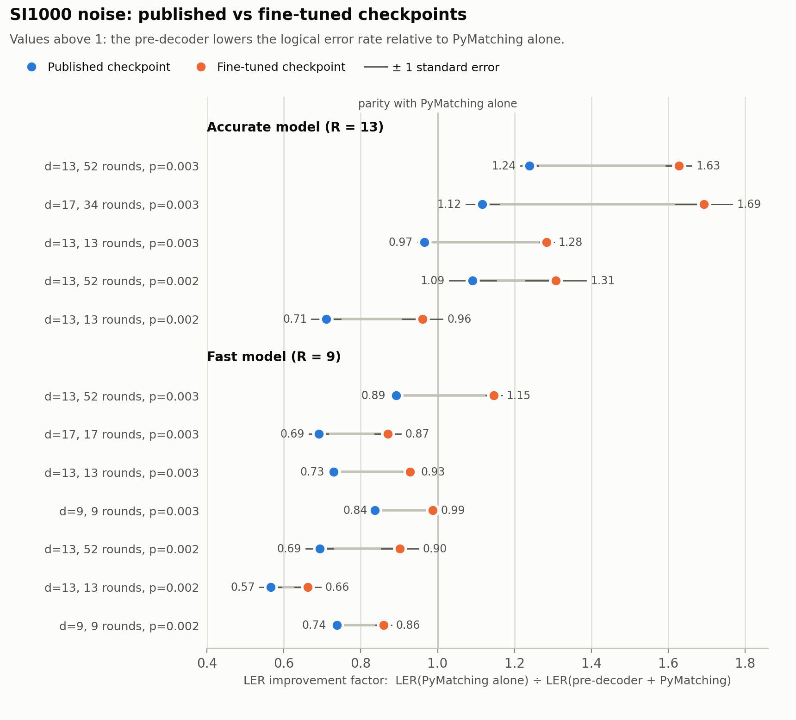
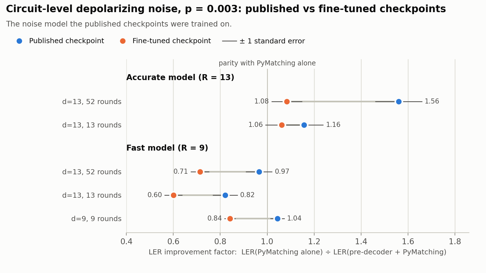
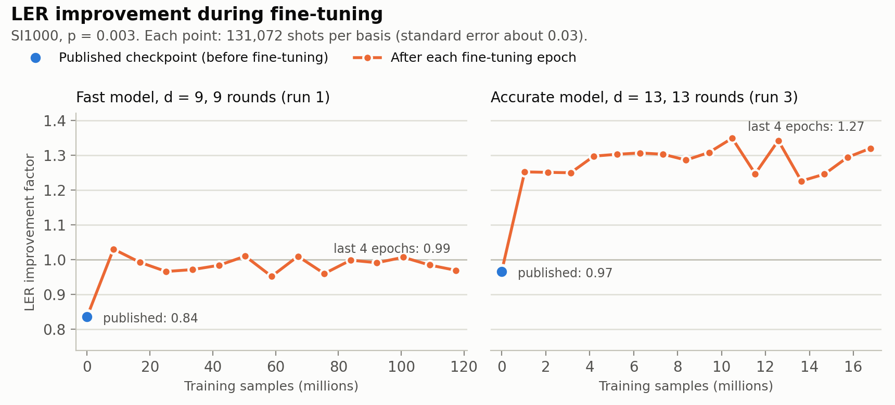
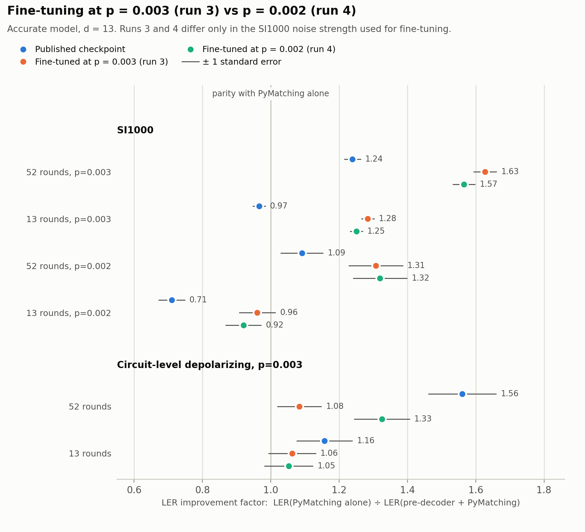
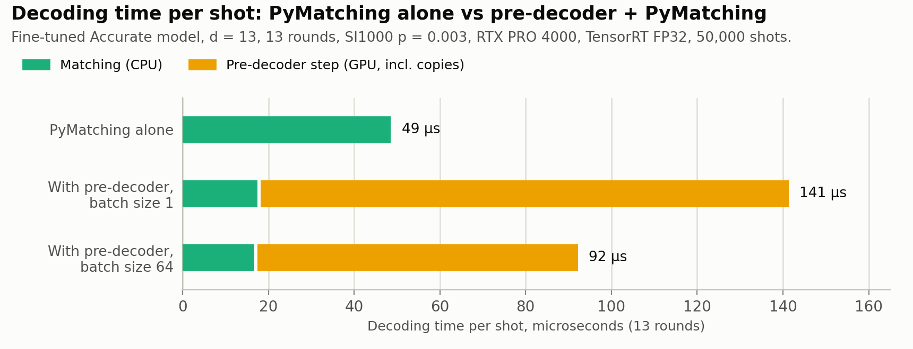

# Fine-tuning NVIDIA Ising surface-code pre-decoders for SI1000 noise

Configurations, scripts, raw logs and analysis for fine-tuning the open
[NVIDIA Ising](https://github.com/NVIDIA/Ising-Decoding) neural pre-decoders
(Chamberland et al., [arXiv:2604.12841](https://arxiv.org/abs/2604.12841)) on
the SI1000 circuit-level noise model, and for measuring the effect on logical
error rate and decoding time.

The published checkpoints were trained on circuit-level depolarizing noise.
Their model cards state that a checkpoint does not transfer to a different
noise model and recommend fine-tuning with the open training pipeline. This
repository quantifies that recommendation for SI1000 on a single workstation
GPU.

**Main result.** For the Accurate model at distance 13 over 52 rounds of
SI1000 noise at p = 0.003, fine-tuning on about 1.7 × 10⁷ samples (6.6 GPU
hours) raises the logical-error-rate improvement over PyMatching alone from
1.24 ± 0.02 to 1.63 ± 0.03. The fine-tuned model performs worse than the
published one on depolarizing noise, and on the GPU used here the combined
pipeline is slower than PyMatching alone.

All results are from simulation. No hardware data is used.



## Methods

**Task.** Rotated surface code memory experiments in the X and Z bases,
distances 9 to 17, 9 to 52 rounds, simulated with the circuit and noise
machinery of Ising-Decoding (which builds on Stim).

**Decoders.** The baseline is minimum-weight perfect matching with
[PyMatching](https://github.com/oscarhiggott/PyMatching). The pre-decoder is a
3D convolutional network that removes locally correctable detection events
and passes the residual syndrome to PyMatching.

**Models.**

| Name | Ising model ID | Parameters | Receptive field |
|---|---|---|---|
| Fast | 1 | 912,772 | 9 |
| Accurate | 4 | 1,797,764 | 13 |

**Noise models.** SI1000 (superconducting-inspired circuit-level noise, with
measurement errors at 5p and two-qubit gate errors at p) at p = 0.003 and
p = 0.002, generated with `NoiseModel.from_si1000(p)` from Ising-Decoding;
and the circuit-level depolarizing model at p = 0.003 on which the published
checkpoints were trained. The explicit parameters are in `training/configs/`.

**Fine-tuning.** Each run starts from a published checkpoint with a fresh
optimizer state and uses NVIDIA's training workflow with on-the-fly sampled
data. Two environment-variable overrides (learning rate, batch size) were
added to NVIDIA's code; see `training/config_validator.patch`.

| Run | Base model | Training noise | Training volume | Samples | Learning rate | Batch size | Wall-clock time |
|---|---|---|---|---|---|---|---|
| 1 | Fast | SI1000, p = 0.003 | d = 9, 9 rounds | 14 × 8,388,608 | 1 × 10⁻⁴ | 512, then 2048 | 7 h 20 min |
| 3 | Accurate | SI1000, p = 0.003 | d = 13, 13 rounds | 16 × 1,048,576 | 7 × 10⁻⁵ | 512 | 6 h 36 min |
| 4 | Accurate | SI1000, p = 0.002 | d = 13, 13 rounds | 16 × 1,048,576 | 7 × 10⁻⁵ | 512 | 6 h 28 min |

Run 2 was not carried out. For scale, the model cards report about
6.3 × 10⁹ training samples for the published checkpoints; runs 3 and 4 each
use about 0.3% of that.

**Metric.** The improvement factor is
LER(PyMatching alone) / LER(pre-decoder + PyMatching), with each logical error
rate averaged over the X and Z bases. Values above 1 mean the pre-decoder
lowers the logical error rate. The baseline is re-measured in every
evaluation run; tables list the baseline LER from the published-checkpoint
run.

**Uncertainty.** Quoted uncertainties are one standard error, propagated from
binomial standard errors of the two logical error rates treated as
independent. They reflect sampling noise in the test shots only. Each
configuration was trained once, so run-to-run variation is not estimated.
Sampling is not seeded.

**Hardware and software.** One NVIDIA RTX PRO 4000 Blackwell (24 GB), Ubuntu
26.04, Python 3.12. Package versions are in `environment/`.

## Results

### SI1000 noise

| Model | Setting | Shots per basis | LER, PyMatching alone | Published | Fine-tuned |
|---|---|---|---|---|---|
| Accurate | d=13, 52 rounds, p=0.003 | 131,072 | 2.408e-02 | 1.24 ± 0.02 | 1.63 ± 0.03 |
| Accurate | d=17, 34 rounds, p=0.003 | 131,072 | 5.413e-03 | 1.12 ± 0.04 | 1.69 ± 0.07 |
| Accurate | d=13, 13 rounds, p=0.003 | 524,288 / 1,048,576 | 5.292e-03 | 0.97 ± 0.02 | 1.28 ± 0.02 |
| Accurate | d=13, 52 rounds, p=0.002 | 262,144 | 1.276e-03 | 1.09 ± 0.06 | 1.31 ± 0.08 |
| Accurate | d=13, 13 rounds, p=0.002 | 1,048,576 | 2.861e-04 | 0.71 ± 0.04 | 0.96 ± 0.05 |
| Fast | d=13, 52 rounds, p=0.003 | 131,072 | 2.382e-02 | 0.89 ± 0.02 | 1.15 ± 0.02 |
| Fast | d=17, 17 rounds, p=0.003 | 262,144 | 2.546e-03 | 0.69 ± 0.02 | 0.87 ± 0.03 |
| Fast | d=13, 13 rounds, p=0.003 | 524,288 | 5.147e-03 | 0.73 ± 0.01 | 0.93 ± 0.02 |
| Fast | d=9, 9 rounds, p=0.003 | 1,048,576 | 1.114e-02 | 0.84 ± 0.01 | 0.99 ± 0.01 |
| Fast | d=13, 52 rounds, p=0.002 | 262,144 | 1.232e-03 | 0.69 ± 0.04 | 0.90 ± 0.05 |
| Fast | d=13, 13 rounds, p=0.002 | 1,048,576 | 2.909e-04 | 0.57 ± 0.03 | 0.66 ± 0.03 |
| Fast | d=9, 9 rounds, p=0.002 | 1,048,576 | 1.585e-03 | 0.74 ± 0.02 | 0.86 ± 0.02 |

Fine-tuned: run 3 for the Accurate model, run 1 for the Fast model.

- Fine-tuning increases the improvement factor in every SI1000 setting
  tested, for both models.
- The gain carries over to a code distance and round count not used in
  fine-tuning (d = 17, 34 rounds).
- The published Accurate model is at or below parity in the 13-round tests;
  the fine-tuned model is above parity at p = 0.003 but not at p = 0.002.
- The fine-tuned Fast model exceeds parity only in the 52-round test at
  p = 0.003.

### Depolarizing noise

| Model | Setting (p = 0.003) | Shots per basis | LER, PyMatching alone | Published | Fine-tuned |
|---|---|---|---|---|---|
| Accurate | d=13, 52 rounds | 262,144 | 1.226e-03 | 1.56 ± 0.10 | 1.08 ± 0.06 |
| Accurate | d=13, 13 rounds | 1,048,576 | 2.108e-04 | 1.16 ± 0.08 | 1.06 ± 0.07 |
| Fast | d=13, 52 rounds | 262,144 | 1.167e-03 | 0.97 ± 0.05 | 0.71 ± 0.04 |
| Fast | d=13, 13 rounds | 1,048,576 | 2.165e-04 | 0.82 ± 0.05 | 0.60 ± 0.04 |
| Fast | d=9, 9 rounds | 1,048,576 | 1.272e-03 | 1.04 ± 0.03 | 0.84 ± 0.02 |

Fine-tuning on SI1000 reduces performance on the original noise model. The
fine-tuned checkpoints are specialised to SI1000.

As a consistency check, the published Accurate model measures 1.56 ± 0.10
here at d = 13 over 52 rounds, compared with 1.53 reported by NVIDIA at 104
rounds.



### Training dynamics



For run 3, the improvement factor at d = 13, 13 rounds rises from 0.97 to
1.25 after the first epoch (1,048,576 samples, about 25 minutes) and
fluctuates between about 1.22 and 1.35 over the remaining fifteen epochs.

### Fine-tuning noise strength

Runs 3 and 4 differ only in the SI1000 strength used for fine-tuning
(p = 0.003 and p = 0.002).

| Test noise | Setting (Accurate, d=13) | Published | Run 3 | Run 4 |
|---|---|---|---|---|
| SI1000 | 52 rounds, p=0.003 | 1.24 ± 0.02 | 1.63 ± 0.03 | 1.57 ± 0.03 |
| SI1000 | 13 rounds, p=0.003 | 0.97 ± 0.02 | 1.28 ± 0.02 | 1.25 ± 0.02 |
| SI1000 | 52 rounds, p=0.002 | 1.09 ± 0.06 | 1.31 ± 0.08 | 1.32 ± 0.08 |
| SI1000 | 13 rounds, p=0.002 | 0.71 ± 0.04 | 0.96 ± 0.05 | 0.92 ± 0.05 |
| Depolarizing, p=0.003 | 52 rounds | 1.56 ± 0.10 | 1.08 ± 0.06 | 1.33 ± 0.08 |
| Depolarizing, p=0.003 | 13 rounds | 1.16 ± 0.08 | 1.06 ± 0.07 | 1.05 ± 0.07 |

On SI1000 the two runs agree within uncertainties, including at p = 0.002.
On depolarizing noise at 52 rounds, run 4 retains more of the published
model's performance than run 3 (1.33 ± 0.08 against 1.08 ± 0.06). With one
training run per configuration and no corresponding difference at 13 rounds,
this is not treated as established.



### Decoding time

Measured with `cpp/src/qec_bench.cpp` (TensorRT 11.4 for the network,
PyMatching's C++ core for matching) on 50,000 X-basis shots: run 3 model,
d = 13, 13 rounds, SI1000 at p = 0.003, FP32.

| Pipeline | Mean time per shot |
|---|---|
| PyMatching alone | 48.6 µs |
| Pre-decoder + PyMatching, batch size 64 | 92.2 µs |
| Pre-decoder + PyMatching, batch size 1 | 141.3 µs |

The pre-decoder reduces the mean number of detection events per shot from
192.0 to 5.8 and the matching time from 48.6 µs to 17.4 µs, but the network
inference and host-device transfers cost more than the matching time saved.
This is a workstation GPU at FP32; it is not the deployment hardware or
precision for which these models are designed.



## Limitations

- Simulation only. SI1000 is a noise model, not device data.
- One training run per configuration; no estimate of run-to-run variance.
- Rotated surface code memory experiments only, d ≤ 17, at most 52 rounds,
  two noise strengths.
- Mixed-noise training, which might retain depolarizing performance, was not
  tried.
- Timing: FP32 engines, one GPU model, X basis only. On one reference set the
  TensorRT output differed from an ONNX Runtime CPU reference on 45 of 20,000
  shots; the cause was not established.
- No new method is proposed. The models, training code and evaluation code
  are NVIDIA's.

## Repository contents

| Path | Contents |
|---|---|
| `training/` | Configurations, patch, and fine-tuning / evaluation scripts ([README](training/README.md)) |
| `cpp/` | C++ pipeline benchmark, TensorRT engine builder, reference-data generator ([README](cpp/README.md)) |
| `logs/` | Raw logs of every training run and measurement, with an index of the settings that produced each ([README](logs/README.md)) |
| `analysis/` | `make_figures.py`, which derives every table and figure from `logs/`, and the generated tables |
| `figures/` | Generated figures |
| `environment/` | Package versions and machine details |

## Reproduction

Tables and figures from the logs (Python 3 and matplotlib):

```bash
python3 analysis/make_figures.py
```

Fine-tuning and evaluation: see [training/README.md](training/README.md).
Timing: see [cpp/README.md](cpp/README.md).

## Model weights

No weights are stored in this repository. The fine-tuned checkpoints (fp16
safetensors and two ONNX exports) are distributed on Hugging Face under the
NVIDIA Open Model License:
[dreamstickkkkk9090/ising-predecoder-si1000-finetune](https://huggingface.co/dreamstickkkkk9090/ising-predecoder-si1000-finetune).
NVIDIA's published checkpoints are available from NVIDIA's Hugging Face pages
(see References) and are not redistributed.

## License

Code and configurations: Apache License 2.0 (see `LICENSE` and `NOTICE`).
`training/config_validator.patch` and `training/configs/` are derived from
NVIDIA's Apache-2.0 Ising-Decoding.

## Acknowledgements

This work builds entirely on the models and training pipeline released by
C. Chamberland, J. Olle, M. Li, S. Thornton and I. Baratta at NVIDIA. Compute
was provided by the author's university. An AI coding assistant (Claude Code)
was used to run the experiments, write the analysis code and draft this
document.

## References

1. C. Chamberland, J. Olle, M. Li, S. Thornton, I. Baratta, "Fast and accurate
   AI-based pre-decoders for surface codes,"
   [arXiv:2604.12841](https://arxiv.org/abs/2604.12841) (2026).
2. NVIDIA, [Ising-Decoding](https://github.com/NVIDIA/Ising-Decoding).
3. NVIDIA, model cards for
   [Ising-Decoder-SurfaceCode-1-Fast](https://huggingface.co/nvidia/Ising-Decoder-SurfaceCode-1-Fast)
   and
   [Ising-Decoder-SurfaceCode-1-Accurate](https://huggingface.co/nvidia/Ising-Decoder-SurfaceCode-1-Accurate).
4. NVIDIA, ["NVIDIA Ising introduces AI-powered workflows to build fault-tolerant quantum systems"](https://developer.nvidia.com/blog/nvidia-ising-introduces-ai-powered-workflows-to-build-fault-tolerant-quantum-systems/)
   (source of the 1.53 figure at 104 rounds).
5. O. Higgott, C. Gidney, [PyMatching](https://github.com/oscarhiggott/PyMatching).
6. C. Gidney, [Stim](https://github.com/quantumlib/Stim).
